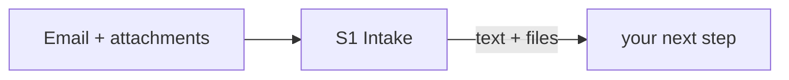

# Future workflow: from email request to response

*Copy this file to `FUTURE_WORKFLOW.md` at your repository root, link it from `APPROACH.md`, and fill in every section. Keep the section headings, the stage IDs and the fixed values exactly as given. Content outside this template is not read for the workflow.*

---

## 1. Diagram

One diagram of how a request travels through your system, from the email arriving to the response leaving, including where a person steps in. Write it as a **Mermaid flowchart** in the code block below.

- Use the stage IDs from section 2 (`S1`–`S9`) as node IDs for those stages. Add any other nodes you need: tools, stores, models, people.
- Label each edge with what passes along it where that isn't obvious.
- Show the failure paths, not just the happy path.

Syntax reminder only. Replace it entirely with your own flow:

---

## 2. Stages

Every request passes through the nine stages below, in whatever order and combination your design uses. These are the jobs that have to be done, not a prescribed architecture. One component may do several stages: say so in the **component** column ("same agent as S3"). Add rows (`S10`, `S11`, …) for anything else your design does.

- **mechanism**: one or more of `RULE` (deterministic code), `RETRIEVAL`, `LLM`, `AGENT_TOOL` (a tool an agent decides to call), `HUMAN`. If you list more than one, say which does what.
- **on failure**: what happens when this stage's input or source is unavailable, sources conflict, or confidence is low, and where the request goes.
- **built?**: `BUILT: <file or function>` or `DESIGNED_NOT_BUILT`.

| stage | what has to happen | mechanism | component / tool | input → output | on failure | built? |
|---|---|---|---|---|---|---|
| S1 | Take in the request: email text and attachments, including scans | | | | | |
| S2 | Work out what is being asked and pull out the facts the checks need | | | | | |
| S3 | Identify the folio, investor and transaction in the records | | | | | |
| S4 | Find the rules that apply to this request (right document, version and client) | | | | | |
| S5 | Run the checks | | | | | |
| S6 | Decide the outcome, reason codes and approval | | | | | |
| S7 | Draft the reply | | | | | |
| S8 | Record what was used and decided (audit trail and `trace`) | | | | | |
| S9 | Human review and approval | | | | | |

---

## 3. Checks (detail of S5)

One row per check your system runs.

| check | data it reads | how it decides (mechanism and rule) | SOP clause | result when its source is unavailable |
|---|---|---|---|---|
| | | | | |

---

## 4. Where people stay in the loop

One row per decision or action a person must take or approve in your design.

| decision or action | who (role) | what they see when asked | why a person (SOP clause or risk) | could it be automated later? on what evidence? |
|---|---|---|---|---|
| | | | | |

---

## 5. Impact

| | % of daily requests | basis (use the volume and mix in CURRENT_WORKFLOW.docx) |
|---|---|---|
| Fully automatic (no person) | | |
| Person confirms the system's proposal | | |
| Person decides | | |

Expected maker and checker minutes per request after the change, and why: ____
