# Future workflow: from email request to response

*Workflow design deliverable for the Validus TCC desk. Stage IDs and fixed values follow
`Data/FUTURE_WORKFLOW_TEMPLATE.md`.*

---

## 1. Diagram

```mermaid
flowchart LR
    IN[Email + attachments / request object] --> S1[S1 Intake]
    S1 -- "text + files" --> S2[S2 Understand & extract]
    S2 -- "facts (folio, PAN, amount, ARN, account)" --> S3[S3 Resolve folio / investor / txn]
    S3 -- "resolved folio, amc, txn_id" --> S4[S4 Find applicable rules]
    S4 -- "SOP v4.1 + AMC addendum" --> S5[S5 Run checks]
    S5 -- "8 check results + evidence" --> S6[S6 Decide outcome + codes + approval]
    S6 --> S7[S7 Draft reply]
    S6 --> S8[S8 Record audit trail + trace]
    S6 -- "PROCEED_MODIFIED / REJECT / HOLD_AND_REFER" --> S9[S9 Human review]
    S9 --> CHK[Checker]
    S9 --> OPM[Operations Manager]
    OPM -- "referral" --> COMP[AMC Compliance]
    CHK -- "approved" --> OUT[Response + reply sent]
    OPM -- "hold approved" --> OUT
    S6 -- "PROCEED / PEND / INVALID_REQUEST" --> OUT
    S7 --> OUT
    S2 -. "LLM unavailable" .-> S2F[Heuristic extract + re-scan raw email]
    S2F --> S3
    S3 -. "folio not found / conflict" .-> S6
    S5 -. "source unavailable" .-> S6
    S5 -. "any check error" .-> S6F[PEND, never PROCEED]
    S6F --> S6
```

Failure paths are shown dashed: an unavailable LLM falls back to heuristics; a missing folio or
conflicting details goes straight to `INVALID_REQUEST`; an unavailable check source or any check
error yields `PEND`, never `PROCEED`.

---

## 2. Stages

| stage | what has to happen | mechanism | component / tool | input → output | on failure | built? |
|---|---|---|---|---|---|---|
| S1 | Take in the request: email text and attachments, including scans | RULE | `src/ingest.py::ingest_attachments` | base64 files + email → decoded text/files | undecodable file is skipped and noted | BUILT: `src/ingest.py` |
| S2 | Work out what is asked and pull out the facts the checks need | LLM then RULE fallback | `src/extract.py::extract` | email + attachment text → facts (folio, PAN, amount, ARN/EUIN, account) | heuristic re-scan of raw email; missing fact → check reports UNABLE_TO_VERIFY | BUILT: `src/extract.py` |
| S3 | Identify the folio, investor and transaction in the records | RULE | `src/checks/folio_identity.py::check_folio_identity` | facts + folio_master/transactions → resolved folio, amc, txn_id | not found or conflict → INVALID_REQUEST (FOLIO_NOT_FOUND / FOLIO_PAN_MISMATCH) | BUILT: `src/checks/folio_identity.py` |
| S4 | Find the rules that apply (right document, version, client) | RETRIEVAL | `src/decide.py` + SOP v4.1 (`Data/policies/`) | received_at + AMC → SOP v4.1 (from 1 Aug 2026; v3.2 superseded) | unknown type/AMC → conservative PEND | BUILT: `src/decide.py`, `notes/contract.md` |
| S5 | Run the checks | RULE | `src/checks/` (8 checks) | resolved facts + extracts → 8 check results with evidence | any unavailable source or exception → UNABLE_TO_VERIFY / PEND | BUILT: `src/checks/__init__.py` |
| S6 | Decide the outcome, reason codes and approval | RULE | `src/decide.py::decide`, `src/contract.py` | check results → outcome + SOP 9.3 codes + approver | precedence is fixed (9.2), so conflicting checks still resolve deterministically | BUILT: `src/decide.py`, `src/contract.py` |
| S7 | Draft the reply | RULE (templated, guarded) | `src/reply.py::build_reply` | outcome + reasons + folio → draft reply | forbidden wording or wrong outcome → safe generic reply | BUILT: `src/reply.py` |
| S8 | Record what was used and decided (audit trail and `trace`) | RULE | `src/solution.py::build_trace` | checks + model calls → `trace` (documents, tools_called, model_calls) | missing trace never blocks the response | BUILT: `src/solution.py` |
| S9 | Human review and approval | HUMAN | Checker / Operations Manager | proposal + evidence → approval or hold | approver unavailable → stays pending | DESIGNED_NOT_BUILT (approval is routed in the response; the queue is not built) |

---

## 3. Checks (detail of S5)

| check | data it reads | how it decides (mechanism and rule) | SOP clause | result when its source is unavailable |
|---|---|---|---|---|
| FOLIO_IDENTITY | folio_master, transactions | RULE: normalise folio formatting, match folio; verify PAN; match PENDING_TCC txn | 9.4 | UNABLE_TO_VERIFY → PEND; missing/conflicting folio → INVALID_REQUEST |
| KYC_STATUS | kra_kyc_snapshot, folio_master | RULE: map KRA status code; Validated/Registered accept; On Hold/Rejected reject | 4.2–4.5 | UNABLE_TO_VERIFY → PEND (never pass) |
| THIRD_PARTY_PAYMENT | transactions, folio_master, bank_mandates, attachments | RULE: payer must be first holder; minors only parents/guardians; employer/custodian exceptions with all docs | 5 | UNABLE_TO_VERIFY → PEND for purchases; NOT_APPLICABLE for redemption/switch-out |
| BANK_MANDATE | bank_mandates, transactions | RULE: proceeds to VALIDATED account only; COB pending → proof required; unregistered account proof | 6.2–6.4 | UNABLE_TO_VERIFY → PEND |
| COB_COOLING | bank_mandates, folio_master, transactions | RULE: COB within 10 days before a redemption → hold; contact change within 30 days → high-risk hold | 6.4, 6.5 | UNABLE_TO_VERIFY → PEND |
| DISTRIBUTOR_CODE | distributor_master, transactions | RULE: ARN must be active and empanelled; invalid → Direct plan; blank EUIN → follow-up | 7.1–7.3 | invalid/unknown ARN → PROCEED_MODIFIED (Direct) or PEND |
| MINOR_RULES | folio_master | RULE: minor folio rules; instalments after majority → pend | 5.4, 5.5 | UNABLE_TO_VERIFY → PEND |
| REFERRAL | folio_master, transactions | RULE: STOP_LOCK, cash > Rs 50k, 25L-in-14-days, TMF A1 | 8.3–8.5 | UNABLE_TO_VERIFY → PEND |

---

## 4. Where people stay in the loop

| decision or action | who (role) | what they see when asked | why a person (SOP clause or risk) | could it be automated later? on what evidence? |
|---|---|---|---|---|
| Approve PROCEED_MODIFIED | TCC Checker | request, resolved folio/txn, the modified check and evidence | SOP Annexure A reserves it to the checker | partly — after a long run of clean outcomes on that rule with a sampled audit |
| Approve REJECT | TCC Checker | request, failing check, SOP clause, evidence, refund route | Annexure A; customer impact | partly — with a sampled audit and no unsafe errors over a period |
| Hold payout / approve referral | Operations Manager | red flags, COB/contact evidence, amount | SOP 6.5, 8.2, 8.4; referral to AMC Compliance | no — a payout hold and referral decision needs a named approver |
| Receive and decide referral | AMC Compliance | request, records relied on, reason code | SOP 8.1–8.2; the RTA does not report | no — reserve to AMC Compliance |

---

## 5. Impact

| | % of daily requests | basis (volume and mix in CURRENT_WORKFLOW.docx) |
|---|---|---|
| Fully automatic (no person) | ~65–70% | PROCEED / PEND / INVALID_REQUEST sign with the maker alone; in the sample cases roughly two thirds |
| Person confirms the system's proposal | ~25–30% | PROCEED_MODIFIED / REJECT need the checker's approval; in the sample these were 3–4 of 15 |
| Person decides | ~5–10% | system cannot decide: gemini or a source unavailable, or details unclear; the maker handles it |

Expected maker and checker minutes per request after the change, and why: about **1–2 minutes** total.
The lookups and rule-matching (about 9 of the 11 maker minutes) move into deterministic checks, so the
maker only reviews the proposal and the checker only confirms the reserved outcomes. The desk volume
(~1,800/day, 2,600 at month-end) stays the same, but effort shifts from retrieval to exception review.
